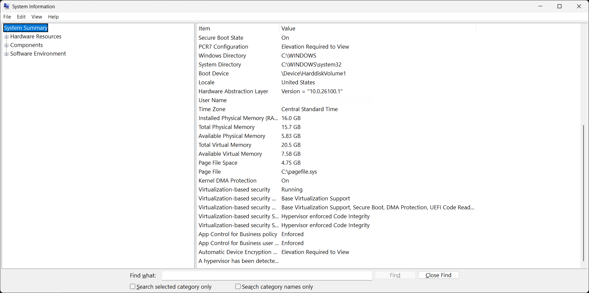
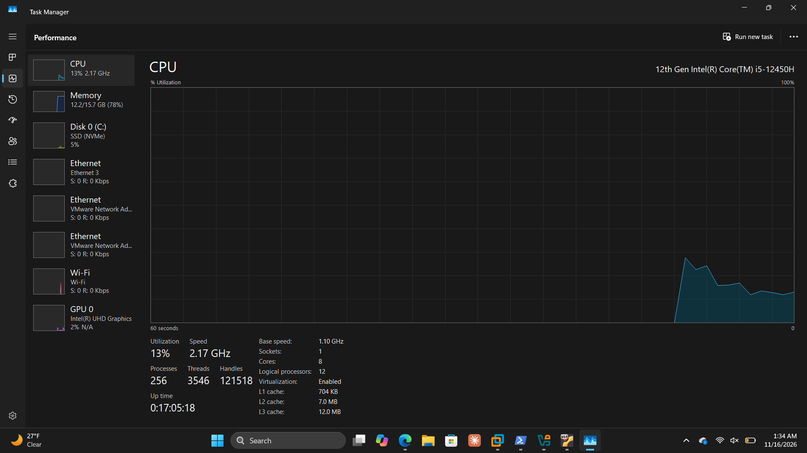
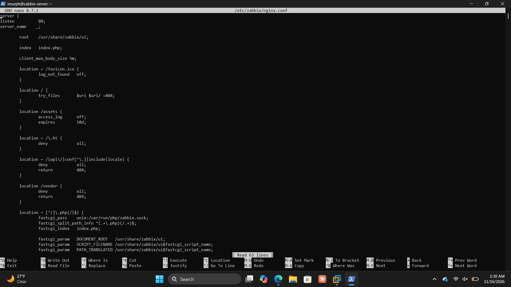
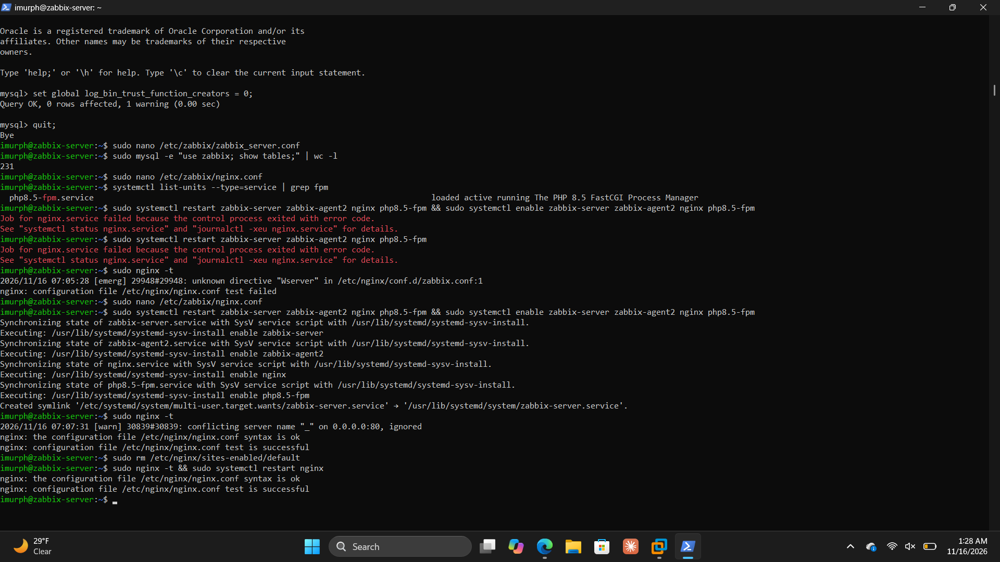
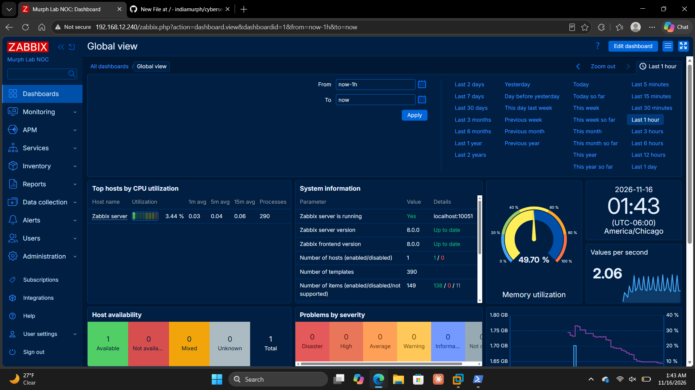

# Lab 0021 — Deploying a Zabbix Monitoring Server on Ubuntu Server

**Date:** 2026-11-15 / 16
**Environment:** VMware Workstation Pro 26H1 on Windows 11 Home; Ubuntu Server 26.04.1 LTS guest (4 GB RAM, 2 vCPU, 25 GB disk, bridged networking)
**Tools:** VMware Workstation Pro, Ubuntu Server, Zabbix 8.0, MySQL 8.4, nginx, PHP 8.5, OpenSSH
**Related objectives:** Network+ N10-009 — network services, monitoring, troubleshooting methodology

---

## 1. Objective

Deploy a working Zabbix monitoring server in an isolated lab, from bare OS install through a functioning web console, and document the failures encountered along the way.

Secondary objective: build familiarity with Zabbix, SNMP, and network monitoring concepts used in Network Operations Center environments.

---

## 2. Scope

All work performed on virtual machines running on my own laptop, on my own home network. No external systems were accessed or tested. The Zabbix console is reachable only from inside the local network and is not exposed to the internet.

---

## 3. Setup

| Component | Detail |
|---|---|
| Host OS | Windows 11 Home |
| Hypervisor | VMware Workstation Pro 26H1u1 |
| Guest OS | Ubuntu Server 26.04.1 LTS |
| Resources | 4 GB RAM, 2 vCPU, 25 GB disk (LVM) |
| Networking | Bridged to physical Wi-Fi adapter; DHCP lease `192.168.12.240/24` |
| Monitoring stack | Zabbix 8.0, MySQL 8.4, nginx, PHP 8.5 |

---

## 4. Methodology

### 4.1 Hypervisor selection

Initial attempt used VirtualBox. The Ubuntu installer hung indefinitely at `Begin: Loading essential drivers`. Diagnosis and resolution in **Finding 1**. Platform was changed to VMware Workstation Pro.

### 4.2 Guest OS installation

Installed Ubuntu Server with:
- Entire disk, LVM, no LUKS encryption (passphrase prompt at every boot would prevent headless reboot)
- Root logical volume expanded from the 11.5 GB default to 22.9 GB to claim unallocated volume-group space
- OpenSSH server installed during setup to allow remote administration

Verified network addressing:

```bash
ip addr show
```

### 4.3 System update and remote access

```bash
sudo apt update && sudo apt upgrade -y
```

Administration moved from the hypervisor console to an SSH session, which allows copy/paste and a resizable terminal:

```bash
ssh imurph@192.168.12.240
```

### 4.4 Zabbix repository and package installation

```bash
wget https://repo.zabbix.com/zabbix/8.0/release/ubuntu/pool/main/z/zabbix-release/zabbix-release_latest_8.0+ubuntu26.04_all.deb
sudo dpkg -i zabbix-release_latest_8.0+ubuntu26.04_all.deb
sudo apt update
sudo apt install zabbix-server-mysql zabbix-frontend-php zabbix-nginx-conf \
  zabbix-sql-scripts zabbix-agent2 zabbix-agent2-plugin-mongodb \
  zabbix-agent2-plugin-mssql zabbix-agent2-plugin-postgresql
```

### 4.5 Database server

The Zabbix packages provide a server binary built for MySQL but do not install MySQL itself. Installed separately:

```bash
sudo apt install mysql-server -y
```

### 4.6 Database creation

```sql
create database zabbix character set utf8mb4 collate utf8mb4_bin;
create user zabbix@localhost identified by '[REDACTED]';
grant all privileges on zabbix.* to zabbix@localhost;
set global log_bin_trust_function_creators = 1;
quit;
```

### 4.7 Schema import

```bash
zcat /usr/share/zabbix/sql-scripts/mysql/server.sql.gz | \
  mysql --default-character-set=utf8mb4 -uzabbix -p zabbix
```

Runs several minutes with no output. Verified afterward:

```bash
sudo mysql -e "use zabbix; show tables;" | wc -l
```

Result: **231 tables**.

Reverted the temporary MySQL setting, which is only required during import:

```sql
set global log_bin_trust_function_creators = 0;
```

### 4.8 Service configuration

Set the database password in `/etc/zabbix/zabbix_server.conf` (`DBPassword=`).

Enabled the web frontend in `/etc/nginx/conf.d/zabbix.conf`:

```nginx
listen          80;
server_name     _;
```

Validated and restarted:

```bash
sudo nginx -t && sudo systemctl restart zabbix-server zabbix-agent2 nginx php8.5-fpm
sudo systemctl enable zabbix-server zabbix-agent2 nginx php8.5-fpm
```

### 4.9 Web setup

Completed the setup wizard at `http://192.168.12.240` — database connection, instance name, timezone — then logged in and immediately changed the default `Admin` password.

---

## 5. Findings

### Finding 1 — Windows hypervisor conflict prevented VirtualBox from running guests

**Symptom:** Ubuntu installer hung at `Begin: Loading essential drivers` for 15+ minutes. A turtle icon appeared in the VirtualBox status bar.

**Investigation:** Task Manager confirmed CPU virtualization was *Enabled*, ruling out a BIOS setting. `msinfo32` reported:

```
Virtualization-based security: Running
App Control for Business policy: Enforced
```

**Cause:** Windows 11 enables Virtualization-Based Security by default. VBS requires the Windows hypervisor, which takes exclusive ownership of the CPU's virtualization extensions (Intel VT-x). VirtualBox was therefore falling back to software emulation, slow enough to appear frozen. Setting `hypervisorlaunchtype off` did not release it, because VBS re-enables the hypervisor independently.

**Resolution:** Rather than disabling VBS — which would reduce the host's security posture — the lab was migrated to VMware Workstation Pro, which coexists with the Windows hypervisor through the Windows Hypervisor Platform API. Memory Integrity and Smart App Control remained enabled throughout.



---



---

### Finding 2 — Documentation prompt markers executed as shell comments

**Symptom:** Pasted installation commands produced no output and no errors. The shell returned immediately to a clean prompt.

**Cause:** Vendor documentation prefixes root commands with `#` to indicate privilege level. In bash, `#` begins a comment — every pasted line was silently discarded. The same class of error occurred again with MySQL instructions, where `mysql>` prompt markers and a literal `password` placeholder were pasted as commands, producing `password: command not found`.

**Resolution:** Stripped prompt markers and substituted `sudo` where root was required.

**Why it matters:** This failure mode produces no error message, which makes it harder to diagnose than a command that fails loudly. Silence is not success.

---

### Finding 3 — nginx failed to start due to a configuration typo

**Symptom:** `systemctl restart nginx` failed with `control process exited with error code`.

**Investigation:**

```bash
sudo nginx -t
```

```
nginx: [emerg] unknown directive "Wserver" in /etc/nginx/conf.d/zabbix.conf:1
nginx: configuration file /etc/nginx/nginx.conf test failed
```



---

**Cause:** A stray character was introduced into line 1 while editing in nano, corrupting the `server {` block declaration.

**Resolution:** Corrected line 1 and re-tested before restarting.

**Takeaway:** `nginx -t` reports the exact file, line number, and offending directive. Running it before every restart converts a vague service failure into a precise, actionable error.



---

### Finding 4 — Default nginx site shadowed the Zabbix frontend

**Symptom:** After nginx started successfully, `http://192.168.12.240` returned the default "Welcome to nginx!" page rather than the Zabbix frontend.

**Cause:** Ubuntu's packaged default site listens on port 80 and was still enabled via a symlink in `/etc/nginx/sites-enabled/`. With two server blocks bound to the same port, nginx served the default.

**Resolution:**

```bash
sudo rm /etc/nginx/sites-enabled/default
sudo nginx -t && sudo systemctl restart nginx
```

Removing the symlink disables the site while leaving the configuration available in `sites-available/`.


---

### Result

Zabbix 8.0 frontend reachable at `http://192.168.12.240`, backed by MySQL with a 231-table schema, with the server monitoring itself as its first host.



---

## 6. Analysis

**Why monitoring servers matter in a NOC.** A Zabbix server is the system that notices problems before customers report them. It polls devices, collects metrics, compares them against thresholds, and raises alerts that analysts triage. In a service-provider environment, the gap between an outage starting and an analyst seeing it is largely determined by how well this layer is configured.

**Why bridged networking rather than NAT.** Bridged places the guest directly on the physical network with its own DHCP lease, so it is reachable from other hosts — necessary for monitoring other devices later. NAT would isolate the guest behind the hypervisor's private network.

**Defense in depth observed during the lab.** The VBS conflict is a useful illustration: Windows uses virtualization itself to isolate kernel memory from malicious drivers. Resolving a tooling conflict by weakening that protection would trade a durable security control for short-term convenience. Switching hypervisors achieved the lab objective without that trade.

**Troubleshooting methodology.** All four findings resolved through the same loop: observe the symptom, gather evidence from the system itself rather than guessing, form a hypothesis, test it, then verify. `msinfo32`, `nginx -t`, and `systemctl status` each named their problem directly once asked.

What surprised me most was how little of the night was actually about Zabbix. Maybe twenty minutes went to installing and configuring it; the rest went to a hypervisor conflict on my own laptop, a documentation convention I misread, and a single stray character I introduced into a config file while editing. The documentation one is ironic — I know # marks a comment, but this system is new enough to me that I assumed it was part of what I needed to run.

I’d never really thought about how many separate pieces — operating system, database, web server, PHP, and the application — all have to agree before a single web page loads. I’m studying for Network+ right now and it reminded me of the OSI model: not the same thing, but the same idea of layers stacked on each other, where a failure at any one layer breaks everything above it.

---

## 7. Remediation / Hardening

Applied or identified during the lab:

- Changed the default `Admin` / `zabbix` credentials immediately after first login. Default credentials on an exposed monitoring console are a routine pentest finding.
- Reverted `log_bin_trust_function_creators` to `0` after schema import; it loosens MySQL function-creation restrictions and should not remain enabled.
- Kept the console on the private network only, with no port forwarding from the internet.
- Preserved host security controls (Memory Integrity, Smart App Control) rather than disabling them for tooling convenience.

Identified for future work:

- Restrict permissions on `/etc/zabbix/zabbix_server.conf` (`chmod 600`), which contains the database password in plaintext.
- Enable HTTPS on the frontend; the console currently serves over HTTP.
- Configure `ufw` to allow only ports 80, 443, 10050, and 10051.
- Replace SSH password authentication with key-based authentication.
- Assign a DHCP reservation so the server's address does not change.

---

## 8. What I Learned

Being that I’m still learning to code, I found it interesting rather than overwhelming that commands don’t translate across languages or operating systems. It’s like learning a second language — one only a machine understands — except in this field I’ll have to learn several.

I learned what Virtualization-Based Security and Memory Integrity are, why Windows 11 enables them by default, and why they conflict with third-party hypervisors.

I also learned that running a command without an error doesn’t mean it worked. I pasted installation commands that began with #, which bash reads as a comment, so nothing ran and nothing complained. That mistake taught me to verify instead of assume — which is why I ran sudo mysql -e "use zabbix; show tables;" | wc -l to confirm 231 tables existed, rather than trusting that the import had succeeded.
Points worth covering:
- Silence is not success. The `#` comment issue produced no error at all.
- Tools diagnose better than guesses. `nginx -t` and `msinfo32` each named the exact problem.
- Security tradeoffs are decisions, not obstacles. Describe why you kept VBS enabled and changed platforms instead.
- What confused you, and how you resolved it.

---

## 9. Next Steps

**Session 2 — Detection (lab-0022)**
- Add a second Ubuntu host monitored via the Zabbix agent
- Configure SNMP polling (`snmpd`, community string, `snmpwalk` verification) and attach an SNMP template
- Simulate and validate detection of:
  - a host-down outage (power off the host)
  - CPU and memory exhaustion (`stress-ng`)
  - network latency and packet loss (`tc`)
- Build a dashboard covering host availability, CPU, and network traffic

**Session 3 — Mitigation (lab-0023)**
- Apply `ufw` firewall rules and connection rate limiting
- Configure `fail2ban` for SSH
- Re-run the Session 2 simulations to confirm the defenses hold

---

## 10. References

- Zabbix 8.0 installation documentation — zabbix.com/download
- Ubuntu Server 26.04 LTS documentation
- Microsoft documentation on Virtualization-Based Security
- nginx documentation — server blocks and configuration testing
