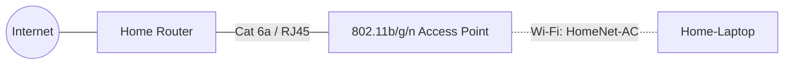

# Lab 1.3.9: Add Wi-Fi to a Home Network

**Domain:** Network Implementation: Wireless
**Environment:** Simulated home network and Windows 11 client
**Result:** 100%

## Objective

Add wireless access to an existing wired home network, then connect the homeowner's laptop to the new WLAN so it reconnects on its own.

## Topology

## What I did

1. **Placed the access point (AP)** near the existing router.
2. **Powered the AP** with its AC-to-DC power adapter.
3. **Wired the AP to the router** with a Cat 6a Ethernet cable, from the AP's port to a free router LAN port.
4. **Turned on the laptop's wireless NIC** using its physical radio switch.
5. **Joined the WLAN:** In Windows 11 I picked the `HomeNet-AC` SSID, ticked **Connect automatically** and connected.
6. **Checked the connection:** Network & Internet settings showed the laptop online with internet access.

## Key concepts

- **Wireless access point vs. router:** The AP bridges wireless clients onto the wired LAN. The router handles routing, NAT and usually DHCP. Because the AP plugs into a router LAN port, wireless clients land on the same subnet as wired ones.
- **802.11 standards:**

  | Standard | Band(s) | Max theoretical rate |
  |----------|---------|---------------------|
  | 802.11b | 2.4 GHz | 11 Mbps |
  | 802.11g | 2.4 GHz | 54 Mbps |
  | 802.11n (Wi-Fi 4) | 2.4 / 5 GHz | 600 Mbps |
  | 802.11ac (Wi-Fi 5) | 5 GHz | ~6.9 Gbps |
  | 802.11ax (Wi-Fi 6/6E) | 2.4 / 5 / 6 GHz | ~9.6 Gbps |

  A "b/g/n" AP is backward compatible with older clients.
- **Cat 6a:** Supports 10 Gbps up to 100 m. That's more than an AP like this needs, but it allows for future upgrades.
- **Hardware radio switch:** Many "Wi-Fi won't connect" tickets come down to a disabled radio, from a physical switch, a function key or airplane mode. Check this before anything else.
- **SSID and auto-connect:** The SSID is the network name. Saving the profile with auto-connect lets the client rejoin without the user doing anything.

## Security notes

A production setup would also need:
- **WPA3-Personal**, or WPA2-AES at minimum, with a strong passphrase. Avoid WEP and TKIP.
- The AP's default admin credentials changed, and WPS turned off.
- A separate guest SSID or VLAN for untrusted devices.

## Takeaways

Adding wireless means adding a Layer 2 bridge, not a new network. Knowing the difference between the AP and the router makes it much easier to troubleshoot "connected, no internet" problems.
