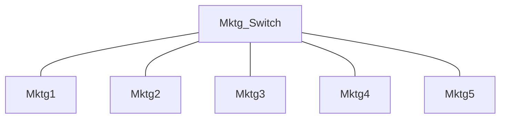

# Build a Star Topology

**Domain:** Networking Concepts: Physical Topologies
**Environment:** Simulated network lab
**Result:** 100%

## Objective

Connect a department's five workstations to one switch so they form a star topology.

## Topology

## What I did

1. Found the central switch for the Marketing department.
2. Ran a separate link from each of the five Marketing workstations to its own switch port.
3. Checked that every host had exactly one link and that the link went to the switch, not to another host.

## Key concepts

- **Star topology:** Every node connects to one central device, usually a switch. It's the most common physical topology in modern Ethernet LANs.
- **Benefits:**
  - If one cable or host fails, only that node goes down.
  - Adding or removing a host is simple: you plug into a free port.
  - Troubleshooting is easier because each link can be isolated at the switch.
- **Weakness:** The central switch is a **single point of failure**. If it goes down, the whole segment loses connectivity.
- **Compared with other topologies:**
  - *Bus:* One shared backbone. If the backbone fails, every host fails with it.
  - *Ring:* Each node links to its two neighbors.
  - *Mesh:* Several redundant paths between nodes. More resilient but costs more.
- **Physical vs. logical:** A star can be wired physically while still behaving differently at the logical level. For example, an Ethernet hub forms a physical star but acts as a logical bus.

## Takeaways

The star layout is why a failed patch cable usually takes down one desk rather than a whole floor. It also shows why core and access switches often get redundant power and uplinks: the center of the star is where the risk sits.
