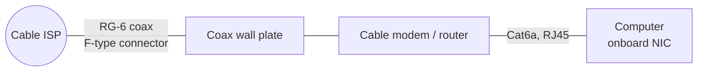

# Connect a Cable Modem for Internet Access

**Exam objective:** N10-009 1.5: Transmission media and transceivers · 2.4: Physical installation
**Course location:** Module 2.2, Lab 10
**Environment:** Simulated home workbench and Windows 11
**Result:** 100%

## Objective

Set up internet service with a cable modem/router: connect it to the provider's coaxial line, connect a computer to it over Ethernet, power it on and confirm the computer can reach the internet.

## Topology

## What I did

1. **Placed the cable modem/router** in the workspace and switched to its rear view.
2. **Connected the WAN side:** Ran an **RG-6 coaxial cable** with **F-type connectors** from the modem's coax input to the coax port on the wall plate.
3. **Connected the LAN side:** Ran a **Cat6a** Ethernet cable from a modem LAN port to the computer's **onboard** Ethernet port. The PC also had an add-in Ethernet card, but the onboard port was the one to use here.
4. **Powered the modem** with its AC-to-DC adapter.
5. **Checked the connection:** Windows 11's Network and Internet settings showed an active internet connection.

## Key concepts

- **Cable broadband:** It runs over the cable TV provider's **hybrid fiber-coax (HFC)** network using the **DOCSIS** standard. The modem turns the RF signal on the coax into Ethernet.
- **WAN vs. LAN ports:**
  - The **coax/WAN** port faces the provider.
  - The **Ethernet/LAN** ports face your devices.
  - Mixing these up is one of the most common home setup mistakes.
- **Coaxial cable types:**

  | Cable | Use | Notes |
  |-------|-----|-------|
  | **RG-6** | Cable internet and TV | Thicker center conductor, better shielding, lower signal loss. Today's standard. |
  | RG-59 | Older or short-run video (CCTV) | Thinner, more loss at high frequencies. Not recommended for broadband. |

- **F-type connector:** The threaded coax connector used on RG-6 for cable modems and TV. Hand-tighten it so it seats fully. A loose F connector is a classic cause of a dropping or slow connection.
- **Modem vs. modem/router combo:**
  - A plain **modem** usually gives one device a public IP address.
  - A **gateway**, or modem/router combo, adds routing, NAT, DHCP and often Wi-Fi, so several devices can share one connection.
- **Picking the right NIC:** When a PC has more than one network adapter, the cable has to go into the adapter that's enabled and configured. A connection in the wrong port looks fine physically but carries no traffic.

## How I'd confirm it outside the simulator

1. **Check the modem lights:** Power, then downstream/upstream locking (DS/US), then Online. If it never reaches Online, the problem is the coax or the provider, not your LAN.
2. **`ipconfig /all`:** Look for a valid address from the modem or gateway rather than an APIPA 169.254.x.x address.
3. **`ping <gateway>` then `ping 8.8.8.8`:** Test the LAN first, then the internet.

## Takeaways

This lab covers the network edge, where the provider's network hands off to the customer's. Telling WAN from LAN and coax from twisted pair, and knowing what the modem's status lights mean, separates "the internet is down" from "my network is down." That's the first question to answer in any home or small office ticket.
