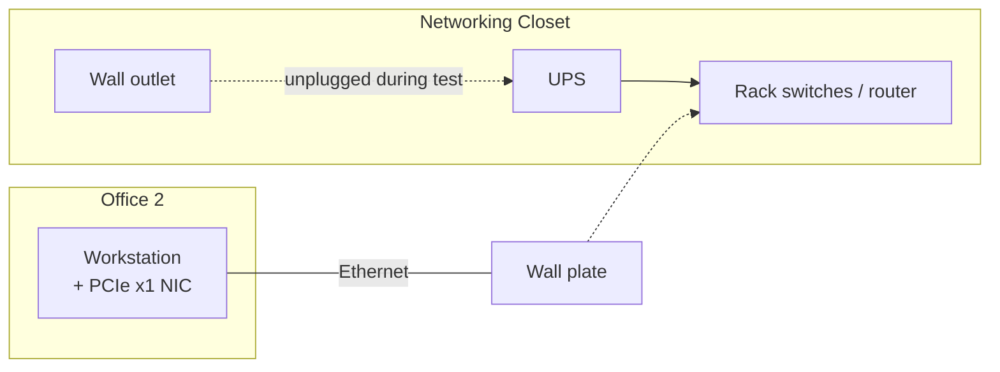

# Install a NIC Safely and Test UPS Failover

**Exam objective:** N10-009 2.4: Physical installation (power, safety)
**Course location:** Module 2.3, Lab 6
**Environment:** Simulated multi-room office (office + networking closet) and Windows 11
**Result:** 100%

## Objective

There were two tasks in two locations:
1. **Office 2:** Install a PCIe network adapter in a workstation, following safe hardware handling, then connect it to the network through the wall plate.
2. **Networking closet:** Check that the uninterruptible power supply (UPS) keeps the network gear running when wall power is lost.

## Topology

## What I did

### Part 1: NIC installation (Office 2)
1. **Shut down safely:** Turned the computer off, then **unplugged AC power** before opening the case.
2. **Installed the adapter** in the free **PCIe x1** slot.
3. **Reconnected power** and connected an Ethernet cable from the NIC to the **data port on the wall plate**.
4. **Booted and checked:** Windows 11's Network & Internet status showed a connection to the network and the internet.

### Part 2: UPS failover test (Networking closet)
1. Moved to the Floor 1 networking closet.
2. **Pulled the UPS's AC plugs** from the wall outlets to simulate a power outage.
3. **Watched the results:** The rack devices' power and activity lights stayed on and the monitors stayed powered. The UPS took over the load with no interruption.

## Key concepts

- **Safety before opening a case:** Power off *and* unplug. An ATX power supply keeps standby voltage on the motherboard even when the PC is "off". Also use an **ESD wrist strap** or touch grounded metal, because static can damage components with no visible sign.
- **PCIe slot sizes:** x1, x4, x8 and x16 are the number of lanes. A x1 card fits and works in any larger slot. A NIC normally needs only x1.
- **What a UPS does:** A battery-backed power source that:
  - keeps equipment running through short outages and brownouts
  - gives enough time for a **clean shutdown** or for a generator to start
  - usually filters surges and spikes

- **UPS types:**

  | Type | How it works | Typical use |
  |------|--------------|-------------|
  | Standby (offline) | Switches to battery when power fails, with a brief transfer time | Desktops, small office |
  | Line-interactive | Corrects small voltage changes without using the battery | Network closets, small racks |
  | Online (double-conversion) | Always runs from the inverter, so there's zero transfer time | Data centers, critical gear |

- **UPS vs. surge protector vs. generator:** A surge protector only clamps spikes. A UPS bridges minutes of outage. A generator covers hours or days but needs a UPS to carry the load while it starts.
- **Test the UPS on purpose.** A UPS with a dead battery looks fine until the power goes out. Scheduled failover tests like this one, plus battery replacement on a schedule, are standard maintenance.

## Takeaways

Two everyday jobs: safe hardware handling, and making sure the network stays up when the power doesn't. In a SOC or IT role, availability is one of the three parts of the CIA triad, and power protection is the most basic availability control there is.
