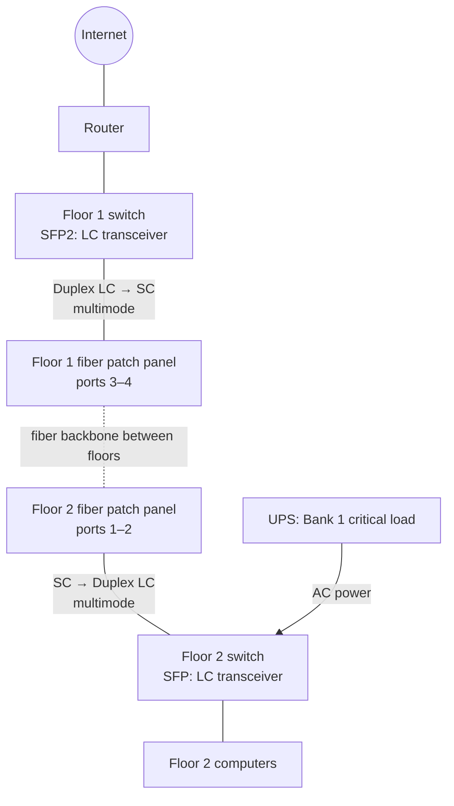

# Connect Switches Between Floors with Fiber

**Exam objective:** N10-009 1.5: Transmission media and transceivers · 2.4: Physical installation
**Course location:** Module 2.3, Lab 7
**Environment:** Simulated two-floor building (two networking closets) and Windows 11
**Result:** 100%

## Objective

Floor 2 had no internet access because its switch wasn't linked to Floor 1. I connected the two closets' switches over **multimode fiber** using **SFP transceivers** and **fiber patch panels**, powered the Floor 2 switch from the UPS, and confirmed Floor 2 computers could reach the internet.

## Topology

## What I did

### Floor 1 closet
1. Installed an **SFP transceiver (LC)** in the switch's **SFP 2** port.
2. Ran an **SC-to-LC multimode fiber patch cable**:
   - the **duplex LC** end went into the SFP
   - the two **SC** connectors (A and B) went into fiber patch panel ports 3 and 4

### Floor 2 closet
3. Installed an **SFP transceiver (LC)** in a free SFP port on the Floor 2 switch.
4. Ran another **SC-to-LC** cable from the SFP to fiber patch panel ports 1 and 2, the other end of the same backbone.
5. Plugged the Floor 2 switch's power cord into a **Bank 1 "critical load" outlet on the UPS** and confirmed it powered up.

### Verification
6. On a Floor 2 computer, Network & Internet showed an active internet connection.

## Key concepts

- **Why fiber between floors:**
  - Copper Ethernet is limited to 100 m.
  - Fiber goes much farther and is **immune to electromagnetic interference (EMI)**.
  - It also doesn't carry electrical ground differences between areas.
  - That makes it the standard for building backbones and riser runs.
- **SFP transceivers:** Hot-swappable modules that let one switch port take different media: multimode or single-mode fiber, or copper. **SFP** is typically 1 Gbps and **SFP+** 10 Gbps. The transceiver must match the fiber type and wavelength at **both ends**.
- **Fiber connectors:**

  | Connector | Description | Typical use |
  |-----------|-------------|-------------|
  | **LC** (Lucent / Little Connector) | Small form factor; the duplex pair clips together | SFP/SFP+ modules, high-density switches |
  | **SC** (Subscriber / Square Connector) | Larger square push-pull connector | Patch panels, older gear |
  | **ST** (Straight Tip) | Round bayonet twist-lock | Legacy installs |

- **Duplex fiber:** Fiber carries light one way per strand, so a link uses **two strands**, one for transmit and one for receive. That's why each end used two patch panel ports. If Tx/Rx are crossed wrong, the link won't come up. Swapping the A/B connectors at one end is the first fix to try.
- **Multimode vs. single-mode:**

  | | Multimode (MMF) | Single-mode (SMF) |
  |---|---|---|
  | Core | 50 / 62.5 µm | ~9 µm |
  | Light source | LED / VCSEL (850 nm) | Laser (1310 / 1550 nm) |
  | Distance | Hundreds of meters | Kilometers |
  | Cost | Lower | Higher |
  | Use | Inside a building or campus | Between buildings, WAN/ISP |

- **UPS critical load outlets:** Many UPS units split their outlets into banks. **Critical load** outlets stay on battery the longest, while non-critical banks may be shed first to stretch runtime. Core network gear like this switch belongs on the critical bank.

## Takeaways

This was my first fiber lab. Picking the transceiver, connector type, fiber mode and patch panel ports is the same set of decisions a network tech makes when connecting IDFs to the MDF. One more point for security work: fiber is much harder to tap than copper, which is one reason backbones use it.
