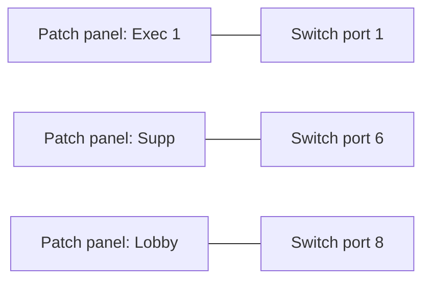

# Patch Panel to Switch Port Mapping

**Exam objective:** N10-009 2.4: Physical installation · 3.1: Documentation (cable maps)
**Course location:** Module 2.3, Lab 9
**Environment:** Simulated networking closet
**Result:** 100%

## Objective

Patch three office drops into specific switch ports according to a port assignment sheet.

## Port map (as built)

| Patch panel port | Location | Switch port |
|------------------|----------|-------------|
| Exec 1 | Executive office 1 | 1 |
| Supp | Support area | 6 |
| Lobby | Lobby | 8 |

## What I did

Using Cat6a patch cables with shielded RJ45 connectors, I connected each labeled patch panel port to its assigned port on the top row of the Cisco switch, following the mapping above exactly.

## Key concepts

- **Why specific ports matter:** On a managed switch, each port can have its own settings:
  - **VLAN membership:** The lobby might sit on a guest VLAN and exec offices on a staff VLAN.
  - **Port security**, such as MAC address limits.
  - **PoE budget** for phones, cameras and APs.
  - **Speed/duplex** settings.

  Patching a drop into the wrong port can put a device on the wrong network.
- **Documentation is part of the job.** A **cable map / port map** like the table above, along with rack diagrams and physical and logical network diagrams, is what makes later troubleshooting fast. If the documentation doesn't match the patching, every outage takes longer.
- **Security angle:** Public-area jacks like the lobby are the easiest physical way into a network. Good practice:
  - put them on an isolated or guest VLAN
  - use **802.1X** port authentication
  - or leave them **unpatched or disabled** until needed

## Takeaways

The task was simple, but it's the habit that counts: patch to the documentation, and update the documentation when you patch. Because of what port assignments control, patching mistakes can also turn into security problems.
