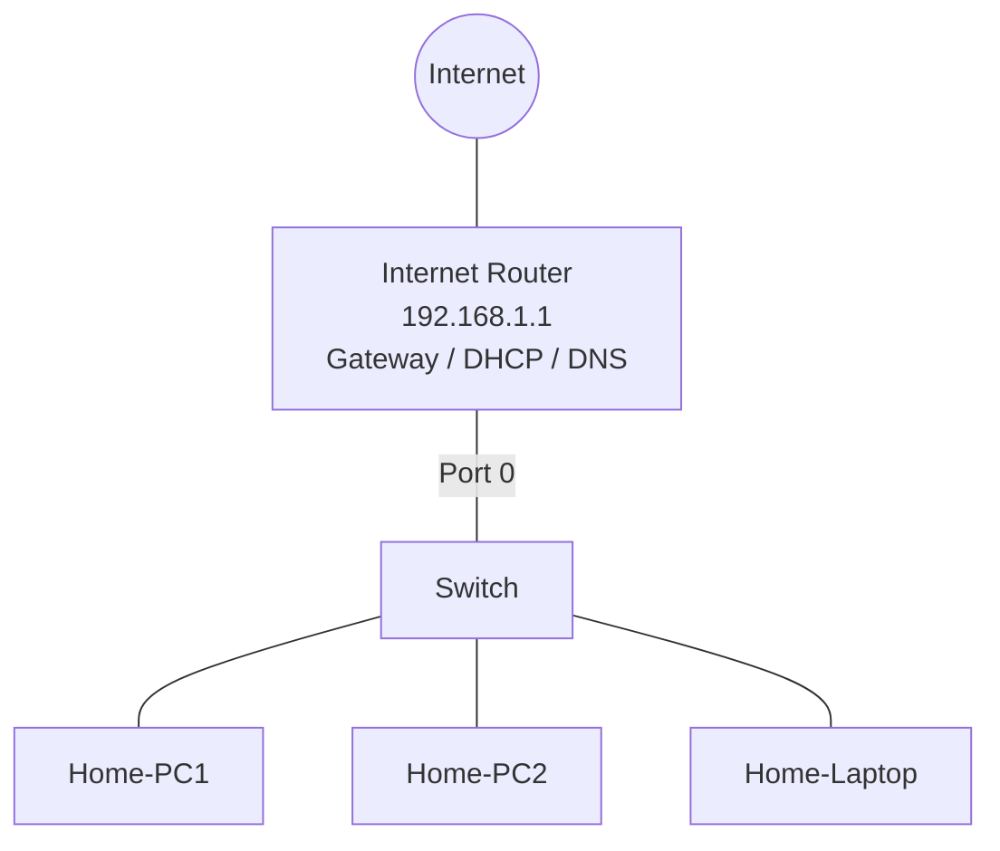

# Lab 1.3.10: Build a SOHO Network

**Domain:** Network Implementation and Operations: Addressing, DHCP, Connectivity Testing
**Environment:** Network modeler canvas and Windows 11 client
**Result:** 100%

## Objective

Build a small office/home office (SOHO) network from scratch: a router, a switch and three endpoints. Then confirm the hosts receive addresses automatically and can reach the gateway.

## Topology



## What I did

1. **Placed the devices:** three end devices, one switch and one router.
2. **Uplinked the switch** to the router's Port 0.
3. **Connected each endpoint** to its own switch port over Ethernet, making a star off the switch.
4. **Checked DHCP** on Home-PC1 in Windows 11 under Network & Internet, Ethernet:
   - The host was given an address on the **192.168.1.0/24** network.
   - The **router (192.168.1.1)** was set as both the default gateway and the DNS server.
5. **Tested connectivity** from an elevated terminal:
   ```powershell
   ping 192.168.1.1
   ```
   All replies came back, so Layer 3 connectivity to the gateway was confirmed.

## Key concepts

- **SOHO router roles:** One consumer box usually acts as router, NAT device, firewall, DHCP server and DNS forwarder all at once. That's why the gateway and DNS addresses were the same here.
- **DHCP (DORA):** The client gets its settings through four messages: **D**iscover, **O**ffer, **R**equest, **A**cknowledge. It receives an IP address, subnet mask, default gateway, DNS server(s) and a lease time.
- **Private addressing (RFC 1918):** 192.168.1.0/24 sits in the private range 192.168.0.0/16, alongside 10.0.0.0/8 and 172.16.0.0/12. These addresses can't be routed on the internet, so NAT translates them at the router.
- **Network address vs. host address:** In a /24 the network ID is `192.168.1.0`, the broadcast address is `192.168.1.255`, and the usable hosts are `.1` to `.254`.
- **APIPA warning sign:** If a host shows **169.254.x.x**, it never reached a DHCP server. Check the cabling and the switch uplink, then renew the lease (`ipconfig /release` then `ipconfig /renew`) or restart the host.
- **ping / ICMP:** Sends ICMP Echo Request messages and waits for Echo Replies. A successful ping to the gateway confirms the cabling, switching and IP settings work up to the edge of the LAN.

## Troubleshooting flow I'd use

1. `ipconfig /all`: Is there a valid address, or APIPA?
2. `ping 127.0.0.1`: Is the TCP/IP stack working?
3. `ping <own IP>`: Is the NIC bound correctly?
4. `ping <gateway>`: Can the host reach the LAN and router?
5. `ping 8.8.8.8`: Can it get past NAT to the internet?
6. `nslookup example.com`: Does name resolution work?

## Takeaways

This lab tied the earlier ones together: a star topology at Layer 1/2, DHCP addressing at Layer 3, and ICMP to check it all. Reading a lease (IP, mask, gateway, DNS) and testing outward step by step are the basics of entry-level network and SOC troubleshooting.
