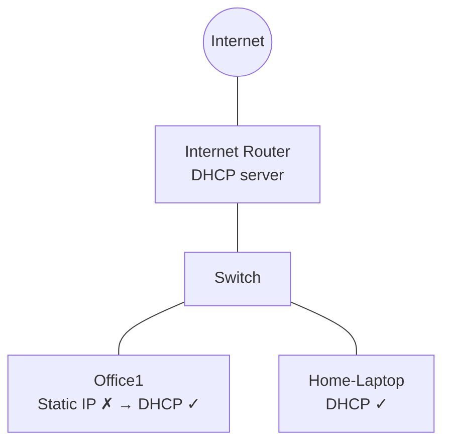

# Lab 1.4.10: Troubleshooting Methodology

**Domain:** Network Troubleshooting: Troubleshooting Methodology, IP Configuration
**Environment:** Network modeler and Windows 11 clients
**Result:** 100%

## Objective

Add two hosts to an existing network. One of them couldn't reach the internet. Find out why and fix it using a structured troubleshooting process.

## Topology



## Walkthrough (following the 7-step troubleshooting methodology)

### 1. Identify the problem
- I connected **Office1** and **Home-Laptop** to the switch, which was already linked to the router.
- I tested each host by loading the same external website in a browser.
  - **Home-Laptop:** The site loaded. Internet access worked.
  - **Office1:** "This site can't be reached." No internet access.
- Both hosts sat on the same switch and router, and only one failed, so the problem was **isolated to Office1**. The router, the switch uplink and the ISP link were all working.

### 2. Establish a theory of probable cause
Possible causes, ordered from simplest and most likely to least likely:
1. Office1's IP configuration is wrong
2. The patch cable to Office1 is bad
3. Office1's NIC has failed
4. The switch port Office1 uses is bad

**Working theory:** The IP configuration. A working host on the same network makes a good baseline to compare against.

### 3. Test the theory
I compared the IP settings on both machines in **Settings → Network & Internet → Ethernet → IP assignment**:

| Host | IP assignment | Internet |
|------|---------------|----------|
| Home-Laptop | Automatic (DHCP) | ✅ |
| Office1 | Manual (static) | ❌ |

The difference supported the theory. Office1 had a manually entered address instead of getting one from the router's DHCP server. Settings that don't match the network will break connectivity, such as an address in the wrong subnet or a missing or wrong gateway or DNS server.

### 4. Establish a plan of action
Switch Office1 to **Automatic (DHCP)** so it gets the same kind of configuration as the working host. This change is low risk and easy to undo.

### 5. Implement the solution
I changed Office1's IP assignment from **Manual** to **Automatic (DHCP)** and saved it.

### 6. Verify full system functionality
I refreshed the browser on Office1 and the website loaded. **Internet access was restored.**

### 7. Document findings
- **Symptom:** A new host couldn't reach the internet. A neighboring host on the same switch could.
- **Root cause:** The host had a static IP configuration that didn't match the network.
- **Fix:** Changed the host to get its settings by DHCP.
- **Prevention:** Use DHCP by default for end-user devices. Save static addresses for servers, printers and network gear, and record them (or use DHCP reservations) to avoid conflicts.

## Key concepts

- **The troubleshooting methodology** (in order): identify the problem, establish a theory, test the theory, plan the fix, implement it, verify it, document it. If a test disproves the theory, go back to step 2 with the next probable cause.
- **Compare against a known-good host:** If one device works and another doesn't on the same network, the shared path is fine. Look at what's different about the failing device.
- **Static vs. dynamic addressing:**
  - *Static:* You enter the IP, mask, gateway and DNS by hand. One typo or a subnet change breaks it.
  - *DHCP:* The router or server hands out matching settings automatically.
- **Commands for next time** (quicker than browsing through Settings):
  ```powershell
  ipconfig /all              # see IP, mask, gateway, DNS, and whether DHCP is enabled
  ping <default gateway>     # can the host reach the router?
  ipconfig /release
  ipconfig /renew            # request a fresh DHCP lease after switching to automatic
  ```

## Takeaways

The fix was a single setting. The real lesson was the method: isolate the fault by comparing against a working host, try the simplest likely cause first, change one thing at a time, and confirm the fix before closing the ticket. A help desk or SOC analyst works through every connectivity issue the same way.
